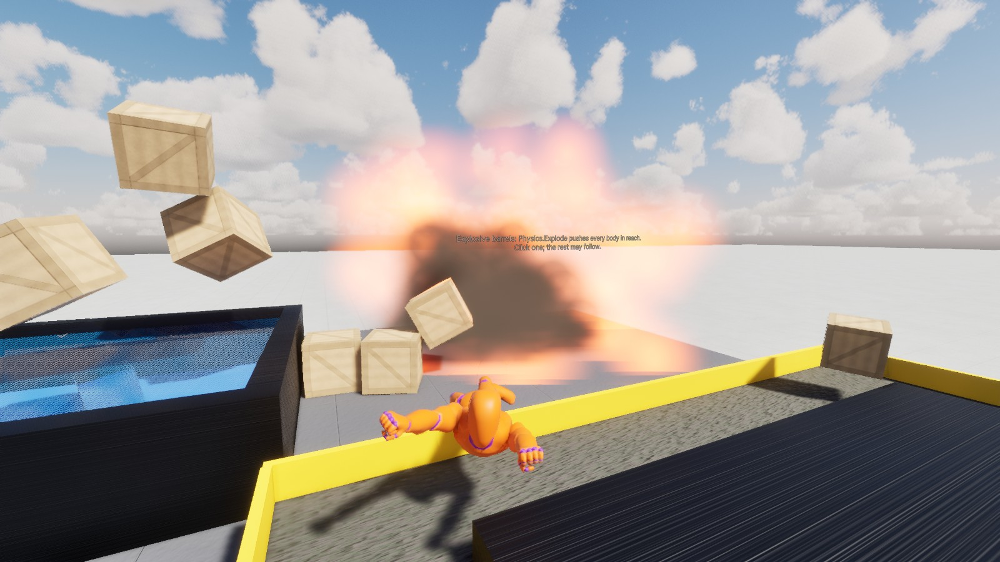

# UnravelEngine Sample: Physics Playground

A walkable playground of six stations around a central plaza, made with
[UnravelEngine](https://github.com/unravel-dev/UnravelEngine). Each station shows a group of the engine's physics
features and lets you try them with a physics tool: push bodies, carry and throw them, press buttons, drive a
buggy, and knock mannequins over.

Open the project in the Unravel editor and press Play. The scene is `data/Scenes/Playground.spfb`, which is also
the startup scene of a deployed build.

## Controls

| Input | What it does |
|-------|--------------|
| W A S D, left stick | Walk; Shift (right trigger) runs, Space jumps |
| Mouse, right stick | Look around |
| Left click | Push what the crosshair is on, or press a button |
| Right click (hold) | Carry a body; left click throws it, the mouse wheel moves it nearer or further |
| E | Press the button or barrel in front of you, get in or out of the buggy |
| R | Put the station you are at back as it started |
| 1 - 6, Tab | Go to a station, or open the station menu |
| F1 | Show the controls |
| Esc | Free the cursor to click the menus; click the view to look around again |

The crosshair tells what a click would do: the mass of a body, "too heavy to carry", a button's action.

## The stations

### 1. Ragdoll Lab

Mannequins whose ragdolls were built from their skeletons by Ragdoll Auto Setup (capsules fitted to the skin,
human joint ranges, masses by body segment).

- Two mannequins walk loops. A light hit staggers only the limb it lands on (`SetBoneSimulated`); a hard one knocks
  them down. They fall with some muscle tone that fades (a powered ragdoll whose drive strength goes to zero), lie
  still, roll onto their back if they fell on their front (`AddAngularVelocity`), and blend into a get-up animation
  placed under their hips (`GetRecoveryPose`, `Recover`).
- A stunt mannequin is dropped down a flight of stairs, and another is fired from a catapult into a pile of crates
  (`RagdollLauncher`, `AddVelocity`).
- A sparring dummy is a powered ragdoll with world drives: it takes your pushes and stays on its feet.

### 2. Joint Workshop

- A door on a hinge with a spring swings shut; a heavy door with joint friction stays where you push it.
- A lift on a slider with a motor, driven against its limits (`MotorSwitch`).
- A wrecking ball on a chain of ten ball joints, swung into a crate wall.
- Newton's cradle: five balls on hinges with perfectly bouncy contacts.
- A windmill turned by a hinge motor, switched on and off with a button.
- A rope bridge made of hinged planks: walk across it.
- A shelf held by fixed joints that break past 4000 N when a weight drops on it (`OnJointBreak`).
- A punching bag on a distance joint used as a rope.

### 3. Materials and Stacking

- Friction ramps of ice, wood and rubber: one crate races down, one slides, one holds.
- A bounce wall: four balls with restitutions from 0.97 to 0 dropped from 3.2 m. Their materials combine
  restitution by maximum, so each ball bounces by its own value.
- Rolling lanes: three balls with rolling resistance 0, 0.08 and 0.35.
- Thirty dominoes on an S curve, a block tower to pull blocks out of, a crate pyramid, and a seesaw catapult.

### 4. Forces and Fields

Sensors that push the bodies inside them (`ForceField`):

- Wind in a tunnel: air that drags bodies towards its speed, so the beach ball flies and the 120 kg block stays.
- Anti-gravity: a column that cancels gravity and a little more.
- Water: buoyancy by depth and density (`Buoyant`). Wood floats, the beach ball rides high, steel sinks.
- A magnet whose sensor includes only the Metal layer: it pulls the steel balls and nothing else.

And:

- A conveyor loop of static belts whose surfaces move (`surface_velocity`).
- Explosive barrels (`Physics.Explode`): click one and its blast throws the crates and the mannequin standing by,
  and may set the other barrels off.
- A lever that changes the gravity of the whole world: Earth, the Moon, Mars, near weightlessness.

### 5. Vehicle Bay

A buggy built from a chassis and four wheel joints: each wheel spins on a motor, rides a spring suspension inside its
limits, and the front two steer. Drive it over a kicker and a jump, into a crate wall, through cones and bowling
pins. W and S drive, A and D steer, Space brakes, F puts it back on its wheels, E gets out.

### 6. Queries

- A laser sweeps across three glass panes to a plate. The panes are sensors: `Physics.Raycast` passes them and stops
  on the plate, `Physics.RaycastAll` with sensors lists every pane and the plate, nearest first.
- A scanner gate over a conveyor asks `Physics.BoxOverlap` what is inside it ten times a second and shows how many
  bodies pass and what they weigh.
- A cart sweeps its box ahead with `Physics.BoxCastAll` and waits while anything is on its track.

## Scripts

All scripts are in `data/Scripts` (namespace `PhysicsSample`):

| Folder | Scripts |
|--------|---------|
| Core | `Hud` (the HUD's data model), `Station` (station text, menu, reset), `StationPart`, `Interactable`, `SlideGate`, `Nudge`, `ImpactSound`, `Heading` |
| Player | `FirstPersonController`, `PhysicsTool` |
| Ragdolls | `RagdollCharacter`, `RagdollLauncher` |
| Joints | `MotorSwitch`, `JointBreakSound` |
| Forces | `ForceField`, `Buoyant`, `ExplosiveBarrel`, `GravitySwitch` |
| Vehicles | `Buggy` |
| Queries | `LaserScanner`, `ScannerGate`, `SweepCart` |

The HUD is `data/UI/Hud.rhtml` and `Hud.rcss`.

## How it was built

The scene was built through the editor's MCP server, not by hand: a script per station created its entities,
components, joints and ragdolls, and the render and physics materials, then played the scene and captured it to
check that each exhibit behaves. The ragdolls were made by Ragdoll Auto Setup and tuned from the bodies' poses the
MCP `physics_world` tool reports.

The textures, particle sprites and sounds were generated for the sample.

## Credits

- Mannequins and animations: Universal Animation Library and Universal Animation Library 2 by Quaternius,
  https://quaternius.com, CC0 1.0.
- Everything else in the project was made for it. Code and all other content are under the MIT license in
  `LICENSE`.
