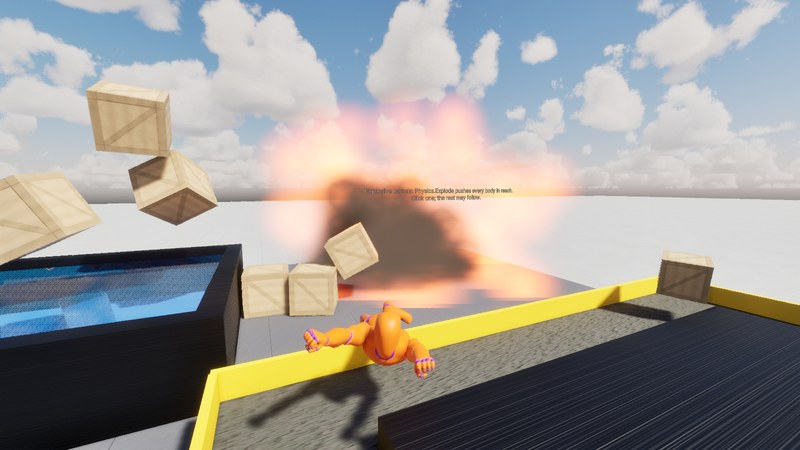
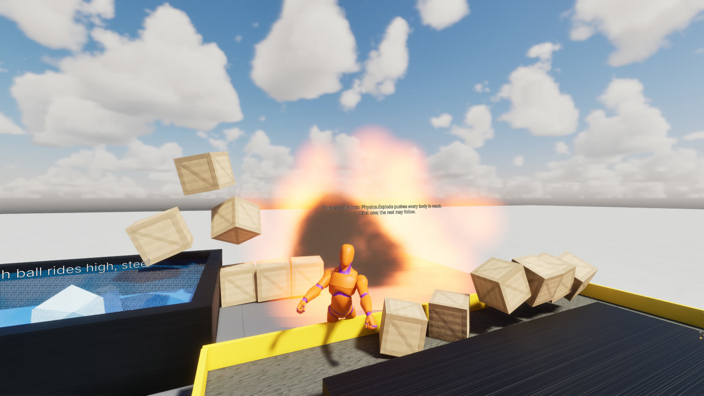
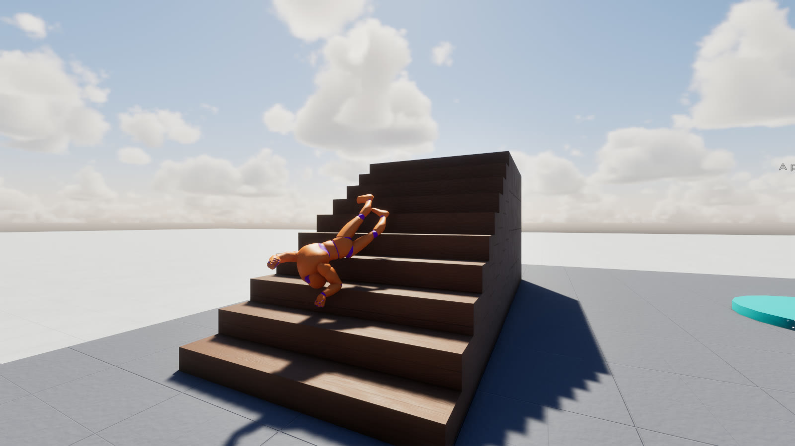
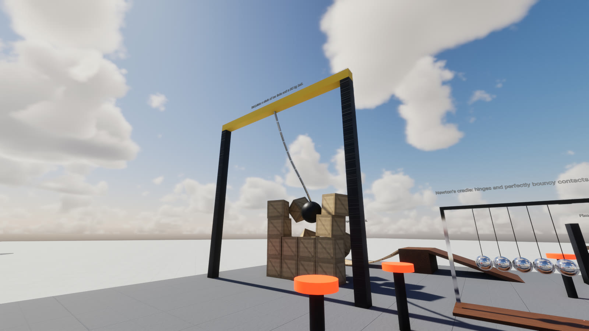
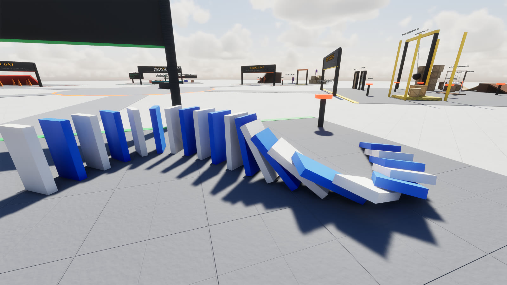
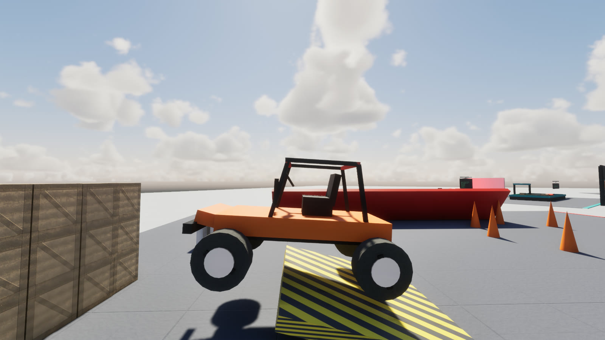

# Physics Playground

A walkable playground of six stations around a central plaza. Each station shows a group of the engine's physics
features and lets you try them with a physics tool: push bodies, carry and throw them, press buttons, drive a
buggy and knock mannequins over. A sample project for [Unravel Engine](https://github.com/unravel-dev/UnravelEngine).

## Play

Clone this repository, or get it from the Samples page of the Unravel editor's start page, and open its folder in
the editor. Open `data/Scenes/Playground.spfb` and press Play; it is also the startup scene of a deployed build.

| Action | Keyboard and mouse | Gamepad | Touch |
|---|---|---|---|
| Walk, run | W A S D, Shift runs | Left stick, right trigger runs | Stick on the left side, pushed all the way to run |
| Look around | Mouse | Right stick | Drag anywhere else |
| Jump | Space | A | Jump |
| Push a body or press a button | Left click | B | Push |
| Carry a body, throw it | Hold right click; left click throws, the wheel moves it nearer or further | Y grabs and puts down, B throws | Grab, then Throw or Drop |
| Use a button or barrel, get in or out of the buggy | E | X | Use |
| Put the station back as it started | R | - | Reset |
| Go to a station | 1 - 6, Tab opens the station menu | - | Stations |
| Show the controls | F1 | - | Help |
| Free the cursor for the menus | Esc, click the view to look again | - | - |

In the buggy, W and S drive, A and D steer, Space brakes, F puts it back on its wheels and E gets out; on a touch
screen the stick drives and the buttons read Brake, Exit and Flip. The crosshair tells what a click would do: the
mass of a body, "too heavy to carry", a button's action.

A touch screen gets the engine's on-screen controls (`SampleTouchJoystick`). The station card moves to the top, out
of the controls' way, folds to its title after a few seconds and opens again on a tap. The layout is in `dp` with
media queries for a phone held sideways or upright, so the Game panel's phone and tablet presets show what a device
shows.

## What it shows

### 1. Ragdoll Lab

Mannequins whose ragdolls were built from their skeletons by Ragdoll Auto Setup (capsules fitted to the skin,
human joint ranges, masses by body segment).

- Two mannequins walk loops. A light hit staggers only the limb it lands on (`SetBoneSimulated`); a hard one knocks
  them down. They fall with some muscle tone that fades (a powered ragdoll whose drive strength goes to zero), lie
  still, roll onto their back if they fell on their front (`AddAngularVelocity`), and blend into a get-up animation
  placed under their hips (`GetRecoveryPose`, `Recover`).
- A stunt mannequin is dropped down a flight of stairs, and another is fired from a catapult into a pile of crates
  (`RagdollLauncher`, `AddVelocity`).
- A sparring dummy is a powered ragdoll with world drives: it takes your pushes and stays on its feet.

### 2. Joint Workshop

- A door on a hinge with a spring swings shut; a heavy door with joint friction stays where you push it.
- A lift on a slider with a motor, driven against its limits (`MotorSwitch`).
- A wrecking ball on a chain of ten ball joints, swung into a crate wall.
- Newton's cradle: five balls on hinges with perfectly bouncy contacts.
- A windmill turned by a hinge motor, switched on and off with a button.
- A rope bridge made of hinged planks: walk across it.
- A shelf held by fixed joints that break past 4000 N when a weight drops on it (`OnJointBreak`).
- A punching bag on a distance joint used as a rope.

### 3. Materials and Stacking

- Friction ramps of ice, wood and rubber: one crate races down, one slides, one holds.
- A bounce wall: four balls with restitutions from 0.97 to 0 dropped from 3.2 m. Their materials combine
  restitution by maximum, so each ball bounces by its own value.
- Rolling lanes: three balls with rolling resistance 0, 0.08 and 0.35.
- Thirty dominoes on an S curve, a block tower to pull blocks out of, a crate pyramid, and a seesaw catapult.

### 4. Forces and Fields

Sensors that push the bodies inside them (`ForceField`):

- Wind in a tunnel: air that drags bodies towards its speed, so the beach ball flies and the 120 kg block stays.
- Anti-gravity: a column that cancels gravity and a little more.
- Water: buoyancy by depth and density (`Buoyant`). Wood floats, the beach ball rides high, steel sinks.
- A magnet whose sensor includes only the Metal layer: it pulls the steel balls and nothing else.

And:

- A conveyor loop of static belts whose surfaces move (`surface_velocity`).
- Explosive barrels (`Physics.Explode`): click one and its blast throws the crates and the mannequin standing by,
  and may set the other barrels off.
- A lever that changes the gravity of the whole world: Earth, the Moon, Mars, near weightlessness.

### 5. Vehicle Bay

A buggy built from a chassis and four wheel joints: each wheel spins on a motor, rides a spring suspension inside its
limits, and the front two steer. Drive it over a kicker and a jump, into a crate wall, through cones and bowling
pins.

The wheels collide as spheres of the tire's radius, with the tires as their visuals: a cylinder collider is a
many-sided prism that bumps over its faces, and would roll slowly and lose grip. Each motor's torque stays below
what a tire can pass to the ground, so the tires grip instead of spinning and keep their grip for steering. The
chassis and wheels interpolate between physics steps, and the chase camera follows in `OnLateUpdate`, so both move
evenly at any frame rate.

### 6. Queries

- A laser sweeps across three glass panes to a plate. The panes are sensors: `Physics.Raycast` passes them and stops
  on the plate, `Physics.RaycastAll` with sensors lists every pane and the plate, nearest first.
- A scanner gate over a conveyor asks `Physics.BoxOverlap` what is inside it ten times a second and shows how many
  bodies pass and what they weigh.
- A cart sweeps its box ahead with `Physics.BoxCastAll` and waits while anything is on its track.

## Screenshots

| | |
|---|---|
|  |  |
|  |  |
|  | |

## Project layout

| Path | What it holds |
|---|---|
| `data/Scenes/Playground.spfb` | The playground: plaza, six stations, player, buggy and HUD. |
| `data/Scripts/Core` | `Hud` (the HUD's data model), `Station` (station text, menu, reset), `StationPart`, `Interactable`, `SlideGate`, `Nudge`, `ImpactSound`, `Heading` |
| `data/Scripts/Player` | `FirstPersonController`, `PhysicsTool` |
| `data/Scripts/Ragdolls` | `RagdollCharacter`, `RagdollLauncher` |
| `data/Scripts/Joints` | `MotorSwitch`, `JointBreakSound` |
| `data/Scripts/Forces` | `ForceField`, `Buoyant`, `ExplosiveBarrel`, `GravitySwitch` |
| `data/Scripts/Vehicles` | `Buggy` |
| `data/Scripts/Queries` | `LaserScanner`, `ScannerGate`, `SweepCart` |
| `data/UI/Hud.rhtml`, `Hud.rcss` | The HUD: crosshair, station card, menu, controls and touch buttons. |

The scripts are in the namespace `PhysicsSample`.

## How it was built

The scene was built through the editor's MCP server, not by hand: a script per station created its entities,
components, joints and ragdolls, and the render and physics materials, then played the scene and captured it to
check that each exhibit behaves. The ragdolls were made by Ragdoll Auto Setup and tuned from the bodies' poses the
MCP `physics_world` tool reports.

## Platforms

| Profile | Notes |
|---|---|
| Desktop | Windows or Linux, as the editor runs on. |
| Android | Phones and tablets, with the on-screen controls. |

Deploy from the editor's Deploy window with a profile from `profiles/`.

## Credits

| Asset | Author | License |
|---|---|---|
| Mannequins and animations: Universal Animation Library and Universal Animation Library 2 | Quaternius, https://quaternius.com | CC0 1.0 |

The textures, particle sprites and sounds were generated for this sample. Code and all other content are under the
MIT license in [LICENSE](LICENSE).
